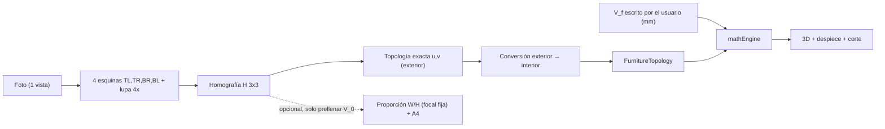

# SmartFurniture: Análisis Técnico Pre-Implementación v2.1

> **Estado:** análisis previo a codificar. No existe código de producción todavía.
> **Fecha:** 20 nov 2026 · **Entrega:** 1 dic 2026 · **Asignatura:** Funciones y Matrices, Unidad 3 (INACAP)
> **Documentos base (sin modificar):** [`pauta.md`](../pauta.md) (Especificación v2.0) y [`Auditoria y Prompts.txt`](../Auditoria%20y%20Prompts.txt) (Auditoría v2.0 + prompts por bloque).
> **Este documento:** recoge todo lo nuevo de la auditoría *red-team*, con evidencia experimental reproducible, y propone las **enmiendas v2.1** que deben aplicarse **antes** de congelar los contratos en el Bloque 1.
> **Para revisores (persona o IA):** la §9 tiene preguntas abiertas concretas. Todo número de este documento se puede reproducir con los scripts de [`docs/evidencia/`](./evidencia/).

---

## 1. Resumen ejecutivo

1. **Los Bloques 1–3 (matemática, corte, 3D) son sólidos y deterministas.** El riesgo real está en el Bloque 4 (**foto → estructura**) y en el **calendario**: el Bloque 1 aún no empieza y la foto está programada al final, con solo 2 días.
2. **Replanteamiento clave:** el usuario **escribe** V_f en mm. De la foto solo se necesita **topología** (posición normalizada de divisores y repisas). La homografía de 4 esquinas entrega esa topología **exacta sin conocer la relación de aspecto**. La escala (A4) y la proporción (Zhang) son secundarias.
3. **Cinco cambios respaldados por experimentos:**

| # | Cambio | Evidencia |
|---|---|---|
| C1 | **Zhang con focal estimada → Zhang con focal fija** (EXIF o 26 mm) | Monte Carlo: en la foto típica de clóset, Zhang falla en el 43 % de los casos, p95 de error 21 %. Con focal fija: p95 2,0 % |
| C2 | **Sobel + "doble borde" → detector de bandas sembrado por la carcasa + confianza** | 4/5 escenarios sintéticos con libros, sombras y gradiente de luz (error ≤ 1,2 mm). El 5.º (blanco sobre blanco) se marca como *no confiable* |
| C3 | **MaxRects → guillotina por franjas** (MaxRects queda como opción) | Pasa los 4 casos límite de kerf. Número de planchas igual al óptimo o a la cota inferior en los 3 presets. Cortable en seccionadora real |
| C4 | **Contratos: aclarar espacio interior/exterior + campos opcionales** | Bug latente de 9 mm detectado (u = 0,25 en mueble de 800 mm) |
| C5 | **Toolchain fijado y verificado** (React 18.3.1, three 0.162.0, R3F 8.18.0, drei 9.122.0, Vite 6, Vitest 3, TS 5.8) | Prueba real: `vitest` ✅, `tsc -b` ✅, `vite build` ✅, bundle sin peticiones externas |

---

## 2. Replanteamiento del problema Foto → 3D



- **Lo que importa:** detectar bien **cuántas** piezas internas hay y **dónde**, y que corregirlo a mano tome segundos.
- **Lo que no importa tanto:** la escala absoluta de la foto, porque V_f la define el usuario con cinta métrica.
- **Regla de producto:** la detección automática es un **asistente**. La ruta manual (lupa, imán, agregar/arrastrar/borrar líneas) es la **ruta garantizada** y siempre debe funcionar.

---

## 3. Evidencia experimental (reproducible)

Ejecutar con Node ≥ 24 (`node --no-warnings <archivo>.ts`) o Node 22 con `--experimental-strip-types`.

### 3.1 Estabilidad de la proporción W/H con 4 clics: [`zhang_sim.ts`](./evidencia/zhang_sim.ts)

Mueble de 1500×2100, lente equivalente de 26 mm, pantalla de 1000×750, **ruido de clic σ = 2,5 px**, 4000 repeticiones por escenario. Error absoluto (mediana / p95):

| Escenario | Euclidiano | Zhang (f estimada) | **Focal fija 26 mm** | Focal fija errada en 15 % |
|---|---|---|---|---|
| Frontal (3°, 3°) | 0,57 / 1,6 % | 0,62 / 1,9 % · f² inválida 37 % | **0,57 / 1,6 %** | 0,57 / 1,7 % |
| **Clóset típico, celular inclinado (15°, 0°)** | 3,3 / 4,7 % | 3,2 / **21,3 %** · f² inválida **43 %** | **0,69 / 2,0 %** | 1,15 / 2,9 % |
| Desde un costado (12°, 20°) | 3,6 / 5,0 % | 0,91 / 2,7 % | **0,80 / 2,3 %** | 1,26 / 3,5 % |
| Muy oblicua (20°, 35°) | 13,0 / 14,3 % | 1,36 / 3,9 % | **1,08 / 3,1 %** | 3,8 / 6,9 % |

**Lectura:** la foto más común de un mueble alto (perspectiva de un punto) es exactamente el caso degenerado de Zhang (`(k₂−1)(k₃−1) → 0`). Con focal fija, el método gana o empata en todos los escenarios.

### 3.2 Detector de estructura: [`bandDetector.ts`](./evidencia/bandDetector.ts) (86 líneas) + [`band_test.ts`](./evidencia/band_test.ts)

Imágenes sintéticas ya rectificadas, con libros aleatorios, sombra bajo las repisas, gradiente de luz 2× y ruido:

| Escenario | Resultado | Error máx. | Tiempo (teléfono Android) |
|---|---|---|---|
| Estantería 800×1800, 4 repisas | ✅ 4/4 | 1,0 mm | ≤ 87 ms |
| Rack TV 1600×550, vano mixto | ✅ 2 divisores + 1 repisa central | 0,0 mm | 20 ms |
| Clóset 1500×2100, 3 izq + 1 der | ✅ 1 divisor + 4 repisas | 0,5 mm | 28 ms |
| Grafito (tablero más oscuro que el hueco) | ✅ 3/3 | 1,2 mm | 28 ms |
| Blanco sobre blanco (0,80 vs 0,88) | ❌ 0/4, pero **marcado NO CONFIABLE** (`interiorMatch` 94 %) | — | 20 ms |

La primera versión detectaba **9 divisores falsos** en el Rack TV (libros blancos). Se corrigió con una regla estructural: un divisor debe tocar la cubierta **y** la base. Esto justifica tener un set de evaluación.

### 3.3 Corte guillotina por franjas: [`guillotine_sim.ts`](./evidencia/guillotine_sim.ts)

Casos límite de kerf del Bloque 2 (kerf 4 mm): pieza de 2440×1220 cabe ✅ · 2×1218 caben en una franja ✅ · 2×1220 requieren 2 franjas ✅ · pieza de 2600×1500 queda en `unplacedPieces` ✅.

| Preset | Plancha pauta 2440×1220 | Plancha Chile 2500×1830 |
|---|---|---|
| Estantería (18 mm) | 2 planchas, 44 % de uso (**óptimo con veta bloqueada**: caben solo 3 filas de 320 mm en 1220 y se necesitan 8184 mm lineales) | **1 plancha**, 57 % |
| Rack TV (18 mm) | 1 plancha, 77 % | 1 plancha, 50 % |
| Clóset (18 mm) | 3 planchas = cota inferior, 74 % | 2 planchas = cota inferior, 73 % |
| Clóset fondo 2×750×2100 (3 mm) | 2 planchas, 53 % | **1 plancha** Durolac 2440×1520, 85 % |

### 3.4 Prueba del toolchain: [`toolchain-spike/`](./evidencia/toolchain-spike/)

Escena R3F con `<Edges>`, `<Line>`, `<Html>`, `CanvasTexture` y `OrbitControls`:
- `vitest run` ✅ · `tsc -b` ✅ (strict) · `vite build` ✅ en 11 s · bundle de 998 kB (277 kB gzip).
- URLs dentro del bundle: **solo** espacios de nombres XML (`w3.org`) y textos de mensajes de error o documentación. **Ninguna petición de red.**
- Peers verificados en npm: `drei@9.122.0` requiere `three >= 0.137`, `@react-three/fiber >= 8`, `react >= 18`.

### 3.5 Limitaciones honestas de esta evidencia
- Las imágenes sintéticas tienen rectificación perfecta, sin compresión JPEG, sin brillos y **sin paralaje**. Prueban que la idea es sólida, **no** que funcione con fotos reales.
- Todavía no se ha probado con fotos reales: esa es la tarea n.º 1 de la §8.

---

## 4. Modos de falla en fotos reales de celular

| # | Falla | Gravedad | Mitigación |
|---|---|---|---|
| 1 | **Paralaje:** se ve la cara superior de las repisas bajas y la inferior de las altas, y la banda aparece 2–8× más gruesa que 18 mm | 🔴 **Sin probar** | Protocolo de foto (§7). En código: flanco unilateral (borde inferior bajo el horizonte, superior sobre él), ajustado con fotos reales |
| 2 | Carcasa blanca + fondo blanco | 🔴 | Ningún método de píxeles lo resuelve. Usar la métrica de confianza → trazado manual |
| 3 | Gran angular 0,5× (distorsión de barril) | 🟠 | Exigir 1×–2× en la UI |
| 4 | Puertas o cajones | 🟠 | Alcance explícito: mueble abierto, sin puertas |
| 5 | Libros, ropa y objetos | 🟡 | Perfiles de **cobertura** (no suma de gradientes) + regla estructural de divisores. Probado |
| 6 | Iluminación lateral y viñeteo | 🟡 | Normalización flat-field `L / blur(L)` con imagen integral. Probado |
| 7 | WhatsApp borra el EXIF; los recortes mueven el punto principal | 🟡 | Enviar como **Documento**. Si falta el EXIF, usar 26 mm. No recortar |
| 8 | Esquinas en mueble blanco sobre pared blanca | 🟡 | La lupa 4× es lo esencial; el imán es opcional |

---

## 5. Enmiendas v2.1 a los contratos (aplicar en el Bloque 1, antes de congelar)

Todos los campos nuevos son **opcionales**, con valores por defecto que mantienen válidos los tests y presets de la v2.0.

```ts
// src/types/contracts.ts: adiciones v2.1

/** ESPACIO DE COORDENADAS (v2.1, normativo):
 *  NormalizedSegment está SIEMPRE en espacio INTERIOR [0,1]^2:
 *    u = 0 → cara interna del lateral izquierdo (x = e); u = 1 → cara interna derecha (x = x_f − e)
 *    v = 0 → cara superior de la base (y = e);           v = 1 → cara inferior de la cubierta (y = y_f − e)
 *  La homografía de la foto entrega espacio EXTERIOR → convertir con exteriorToInterior(). */

export interface FurnitureTopology {
  // ...campos v2.0 sin cambios...
  detectionSource?: 'manual' | 'auto' | 'preset';
  /** 0..1. Si < 0,5, la UI debe pedir revisión/trazado manual. */
  detectionConfidence?: number;
}

export interface ScaleAndBoardParams {
  // ...campos v2.0 sin cambios...
  /** Margen de escuadrado por borde (Sodimac/Imperial: 10–15 mm). Por defecto 0. */
  trimMm?: number;
  /** Por defecto 'guillotine' (cortable en seccionadora). 'maxrects' es opcional. */
  packingStrategy?: 'guillotine' | 'maxrects';
  /** Plancha del fondo de 3 mm (Durolac Chile 2440×1520). Por defecto = sheetDimensions. */
  backPanelSheetDimensions?: { width: number; height: number };
}
```

```ts
// src/core/mathEngine/index.ts: helpers v2.1 (puros, con tests)
/** p_int = (p_ext − e/dim) / (1 − 2e/dim) */
export const exteriorToInterior = (p: number, e: number, dim: number) => (p - e / dim) / (1 - (2 * e) / dim);
export const interiorToExterior = (p: number, e: number, dim: number) => p * (1 - (2 * e) / dim) + e / dim;
```

**Test obligatorio:** `exteriorToInterior(0.25, 18, 800) ≈ 0.2382` (sin la conversión, el error es de 9 mm).

**Aclaraciones normativas adicionales** (ya identificadas en la auditoría anterior):
- **Vanos mixtos:** descontar `e/2` también cuando un **extremo** de la repisa termina sobre un divisor (no solo cuando lo cruza). Rack TV, repisa central = **503,33 mm**. Clóset: repisas de **723 mm** (`18 + 723 + 18 + 723 + 18 = 1500`).
- **Altura 3D de las repisas:** `a_n` es la **cara inferior** → centro `cy = a_n + e/2`.
- **División del fondo:** dividir también cuando un lado supera el **lado mayor** de la plancha, no solo cuando ambos superan el menor.

---

## 6. Cambios de algoritmo y stack

### 6.1 Visión (Bloque 4, núcleo en `src/core/vision/`)
1. **Proporción:** fórmula vectorial de Zhang con **focal fija** `f_px = f35 / 43,27 · diagonal_px` (f35 del EXIF `FocalLengthIn35mmFilm`; si no existe, 26).
2. **Rectificación:** muestreo bilineal vía `toCanvas`, con ancho adaptativo para que el tablero mida ≥ 6 px: `W = max(360, ceil(6·x_f/e))`.
3. **Detector de bandas sembrado por la carcasa** (implementación de referencia en `docs/evidencia/bandDetector.ts`):
   - Normalización flat-field → modelo del canto aprendido de los laterales (mediana + MAD) → máscara binaria → perfiles de **cobertura** → filtro adaptado 1D de espesor conocido con **ambos** flancos apagados → divisores primero (deben tocar cubierta y base) → repisas **vano por vano** → conversión a espacio interior → `interiorMatch` como confianza.
   - Limitaciones: no detecta divisores parciales (se agregan a mano) y requiere un V₀ aproximado para el espesor esperado.
4. **Profundidad Z:** preset por tipología (320 / 400 / 500 / 550 mm) o input manual. **La vista lateral ZY pasa a ser opcional** (recorte de alcance).
5. **Conexión con la Unidad 3** para el video: perfiles de proyección = **sumatorias**; filtro adaptado = **convolución discreta**; H = **matriz 3×3** resuelta por eliminación gaussiana 8×8.

### 6.2 Corte (Bloque 2)
- **Por defecto: guillotina de 2 etapas.** Se cortan franjas a lo largo de la veta (alto de franja = profundidad de la pieza), y cada franja se llena por largo (First-Fit Decreasing, tolerancia de altura ≤ 25 %). El kerf usa el mismo truco de padding virtual de la v2.0.
- **Por qué:** en un mueble casi todas las piezas comparten `alto = z_f`, así que el problema 2D **se reduce a 1D**. El plano resultante se puede cortar en seccionadora y se explica con sumatorias.
- MaxRects BSSF queda como `packingStrategy: 'maxrects'` (opcional, si hay tiempo).
- Los formatos de plancha chilenos (2500×1830 melamina, 2440×1520 Durolac) se exponen como selector. **2440×1220 sigue siendo el valor por defecto** (pauta y tests).

### 6.3 Toolchain fijado (verificado §3.4)

```json
{
  "dependencies": { "react": "18.3.1", "react-dom": "18.3.1", "three": "0.162.0",
                    "@react-three/fiber": "8.18.0", "@react-three/drei": "9.122.0" },
  "devDependencies": { "@types/react": "^18.3.12", "@types/react-dom": "^18.3.1", "@types/three": "0.162.0",
                       "@vitejs/plugin-react": "^4.3.4", "typescript": "~5.8.3", "vite": "^6.3.5", "vitest": "^3.2.4" }
}
```

- **No usar `vite@latest`** (8.x, bundler nuevo sin verificar en este stack).
- **Nota Termux (solo si el agente compila en Android):** `npm run` / `npx` fallan con `sh: vitest: not found` porque no existe `/usr/bin/env`. Ejecutar directamente: `node node_modules/vitest/vitest.mjs run`, `node node_modules/typescript/bin/tsc -b`, `node node_modules/vite/bin/vite.js build`. En Windows, los scripts normales funcionan. Si los bins quedan incompletos, `npm rebuild` los regenera.
- **Gate offline:** el `grep` de URLs se aplica a `src/` e `index.html`. En `dist/` siempre aparecerán espacios de nombres XML y textos de error de React/three, que no son peticiones.

---

## 7. Protocolo de foto (para el equipo y para mostrarlo en la UI)

1. Mueble **abierto**, sin puertas, idealmente con poco contenido.
2. Celular **centrado** y a **media altura** del mueble.
3. Alejarse **≥ 3 m** y usar zoom **1× o 2×**. **Nunca 0,5×.**
4. Que se vea el mueble completo, sin recortar la foto.
5. Enviar por WhatsApp **como Documento** (conserva el original y el EXIF), o por USB/Drive.
6. Opcional: hoja A4 pegada en el frente del mueble.

---

## 8. Plan reordenado (20 nov → 1 dic)

La visión avanza **en paralelo desde hoy** (es TS puro y solo depende de `homography.ts`). El Bloque 4 queda solo como integración de UI.

| Fecha | Pista principal (bloques) | Pista paralela de visión (1 integrante) |
|---|---|---|
| **20–21 nov** | Bloque 1: contratos **v2.1** + homografía + presets + mathEngine + tests | **Tomar 10–15 fotos reales** (protocolo §7) y anotar a mano su verdad (u, v de cada pieza) |
| 22–23 nov | Bloque 2: guillotina por franjas + SVG + tests | Rectificación + port del `bandDetector` a Vitest + medir con las fotos reales |
| 24–26 nov | Bloque 3: Viewer3D + MathPanel + App + 3 presets | Manejo de paralaje (flanco unilateral) y ajuste de umbrales con la tabla de resultados |
| 27–28 nov | Bloque 4: **solo UI** de VectorCanvas (lupa, edición, botón "Detectar", confianza) | Congelar el detector; elegir las fotos para el video |
| 29–30 nov | Grabación: **primero la matemática de la Unidad 3 (presets)**, después el "wow" de la foto | — |
| **1 dic** | Entrega | — |

**Compuertas sin cambios:** `vitest` en verde para avanzar; `build` en verde desde el Bloque 3; verificación offline antes de grabar.

---

## 9. Preguntas abiertas para revisores

1. **Paralaje:** ¿hay un método más simple que el flanco unilateral para elegir el canto frontal entre las dos líneas que genera una repisa vista desde arriba o abajo? (Por ejemplo, ¿usar la sombra bajo el canto como ancla?)
2. **Blanco sobre blanco:** ¿existe alguna señal barata (bordes de sombra, textura del tapacanto) que lo rescate sin modelos de ML?
3. **¿Es aceptable académicamente** que la detección sea un asistente (no 100 % automático) y que la vía manual sea la garantizada?
4. **Guillotina vs. MaxRects:** ¿el docente valorará más el realismo de taller (guillotina) o el algoritmo "más sofisticado"? ¿Vale la pena implementar ambos?
5. **Alcance:** ¿recortar la vista lateral ZY es aceptable, dado que el usuario escribe V_f?
6. **Contratos:** ¿falta algún campo opcional que convenga congelar ahora (por ejemplo, retranqueo de repisas o zócalo)?

---

## 10. Índice de archivos

| Archivo | Contenido |
|---|---|
| [`docs/RESUMEN_PARA_EL_EQUIPO.md`](./RESUMEN_PARA_EL_EQUIPO.md) | Versión simple de este análisis, para personas |
| [`docs/evidencia/zhang_sim.ts`](./evidencia/zhang_sim.ts) | Monte Carlo de la proporción W/H |
| [`docs/evidencia/bandDetector.ts`](./evidencia/bandDetector.ts) · [`band_test.ts`](./evidencia/band_test.ts) | Detector de referencia + prueba de estrés |
| [`docs/evidencia/guillotine_sim.ts`](./evidencia/guillotine_sim.ts) | Prototipo de corte en franjas + casos de kerf |
| [`docs/evidencia/toolchain-spike/`](./evidencia/toolchain-spike/) | Configuración verificada (copiar e instalar con `npm install`) |
| `.agents/skills/` | 6 skills de Antigravity actualizadas a v2.1 (guían la implementación por bloque) |
