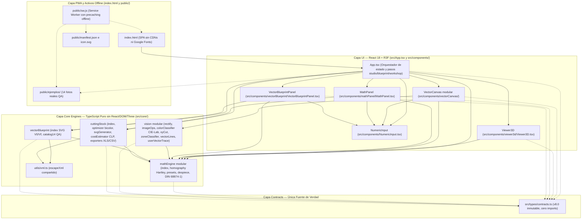

# 01 — Diagrama de Componentes y Paquetes (SmartFurniture v8.0)

> Arquitectura en capas con **Grafo Acíclico Dirigido (DAG)** estricto, separación de responsabilidades entre UI React/WebGL y motores matemáticos puros en TypeScript, y cumplimiento **100 % offline**.

## Diagrama de Componentes y Capas

## Submódulos Internos de `src/core/` y `src/components/vectorCanvas/`

- **`src/core/mathEngine/`**: Álgebra lineal proyectiva `3x3` con normalización isotrópica de Hartley (`homography.ts`), 3 presets oficiales INACAP (`presets.ts`), conversión `exteriorToInterior`/`interiorToExterior`, escalamiento matricial Unidad 3 (`scaleBaseMatrix`), progresión aritmética de repisas, análisis de flexión `DIN 68874-1`, resolución de apoyo (`none`, `legs`, `wheels`, `toe_kick` 4 lados), `FrontZone` (puertas, vidrio, cajones 5 piezas, canastos, `leg_void`, `void_outside` multi-esquina), diagonales con inglete y generación 1:1 de `BoardPiece`.
- **`src/core/vision/`**: Rectificación bilineal RGBA, focal fija Zhang (`26 mm` / `52 mm`), detección de contorno proyectivo, pipeline modular (`imageOps`, `colorClassifier` en espacio perceptual **CIE-Lab**, `xyCut` recursivo + detección consciente de paralaje, detector diagonal `dEdge` `18°-72°`, `zoneClassifier`), extracción de líneas vectoriales y vectorización guiada (`userVectorTrace.ts`).
- **`src/core/cuttingStock/`**: Separación estricta por `(espesor, material)` para muebles bicolor y fondo 3 mm, empaquetado Guillotina 2 etapas / MaxRects con kerf virtual-pad y `trimMm`, generador SVG vectorial offline (`svgGenerator.ts`), estimador BOM + presupuesto editable CLP (`costEstimator.ts`) y exportadores nativos `.xls` SpreadsheetML 3 hojas / `.csv` Excel Chile (`exporters.ts`).
- **`src/core/vectorBlueprint/`**: Motor SVG de alzado frontal + perfil lateral ZY (`V0` vs `Vf`) con simbología de carpintería y catálogo de validación de 14 muebles reales (`catalog14.ts`, `detectionSource: 'preset'`).
- **`src/components/vectorCanvas/`**: Editor interactivo modular de 3 pasos (`frame` -> `lines` -> `zones`), lupa 4x, zoom/pan, trazado a 60 fps, Undo/Redo completo, subherramientas `calibA4`/`eyedropper` e inspector unificado de zonas.

## Matriz de Fronteras Permitidas y Prohibidas (Regla DAG)

| Capa / Módulo | Imports Permitidos | Imports Prohibidos |
|---|---|---|
| `src/types/contracts.ts` | Ninguno (tipos puros TypeScript). | Cualquier archivo de `src/core/`, `src/components/`, React o librerías externas. |
| `src/core/utils/xml.ts` | Ninguno (TypeScript puro). | React, DOM, `contracts.ts` o cualquier otro módulo de `src/`. |
| `src/core/mathEngine/` | `src/types/contracts.ts` y submódulos internos de `mathEngine`. | `vision`, `cuttingStock`, `vectorBlueprint`, `components`, React, DOM, Three.js, red. |
| `src/core/vision/` | `src/types/contracts.ts` y `src/core/mathEngine/`. | `cuttingStock`, `vectorBlueprint`, `components`, React, DOM (`window`/`document`), WASM/CDNs. |
| `src/core/cuttingStock/` | `src/types/contracts.ts`, `src/core/mathEngine/`, `src/core/utils/xml.ts`. | `vision`, `vectorBlueprint`, `components`, React, DOM, Three.js, librerías de Excel externas. |
| `src/core/vectorBlueprint/` | `src/types/contracts.ts`, `src/core/mathEngine/`, `src/core/utils/xml.ts` (y tipos de `vision`). | `cuttingStock` (excepto tipo `CuttingPlanResult`), `components`, React, DOM. |
| `src/components/*` y `src/App.tsx` | `src/types/contracts.ts`, `src/core/*`, React, R3F/Drei/Three (`Viewer3D`), `lucide-react`. | URLs externas (`http://`/`https://`), `<Environment preset>`, `<Text>` sin fuente local, `fetch()` a internet. |
| `public/sw.js` | Cache API y fetch **strictly same-origin** (`url.origin === self.location.origin`). | Cualquier origen externo, CDNs o telemetría. |
