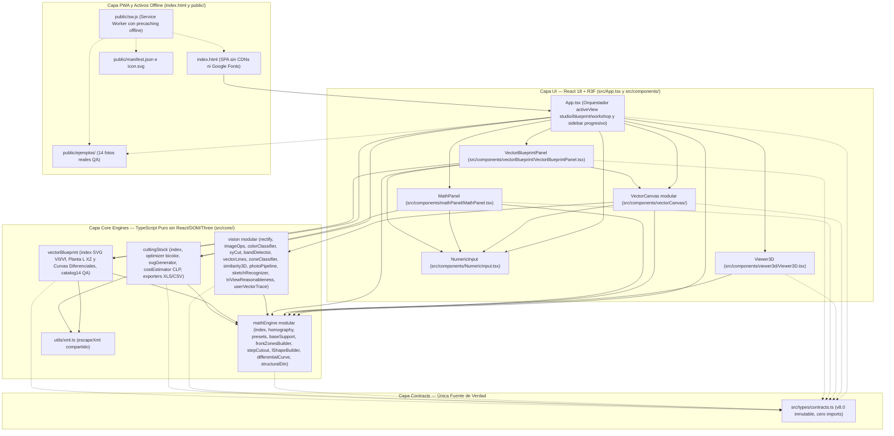

# 01 — Diagrama de Componentes y Paquetes (SmartFurniture v8.0)

> Arquitectura en capas con **Grafo Acíclico Dirigido (DAG)** estricto, separación de responsabilidades entre UI React/WebGL y motores matemáticos puros en TypeScript, y cumplimiento **100 % offline**.

## Diagrama de Componentes y Capas

## Submódulos Internos de `src/core/` y `src/components/vectorCanvas/`

- **`src/core/mathEngine/`**:
  - `index.ts`: Orquestador `calculateDespiece` (generación 1:1 de `BoardPiece` para mueble recto y en L, consolidación `n x 3` / `n x 5`, descuentos de vanos mixtos y tapacanto bicolor).
  - `homography.ts`: Álgebra lineal proyectiva `3x3` con normalización isotrópica de Hartley (`computeQuadToUnitHomography`, `applyHomography`).
  - `presets.ts`: 3 presets oficiales INACAP Unidad 3 (`estanteria`, `rack_tv`, `closet`) + 3 presets en L (`escritorio_l`, `cocina_l`, `closet_l`) y clonado inmutable.
  - `baseSupport.ts`: Resolución unificada de apoyo inferior (`none`, `legs`, `wheels`, `toe_kick` 4 lados), coordenadas 3D/L `computeSupportLegCoordsMm` y herrajes de apoyo sin alterar cotas de melamina.
  - `frontZonesBuilder.ts`: Carpintería de `FrontZone` (puertas simples/dobles/vidriadas con `isGlassDoor` y `handleSide`, cajones de 5 piezas, canastos metálicos en herrajes, `leg_void`, faldones y recorte de holgura frontal en esquina L).
  - `stepCutout.ts`: Recorte geométrico de zonas exteriores `void_outside` multi-esquina (muebles escalonados en perfil frontal XY o con rebajes).
  - `lShapeBuilder.ts`: Resolución constructiva en planta XZ a 90° (`resolveLShapePlan`, `resolveCornerFrontClearance`), transformación rígida 3D del ala de retorno (`transformReturnPieceToWorld`), adaptadores `LShapeWingConfig <-> FurnitureTopology` y fusión de herrajes entre ambas alas.
  - `differentialCurve.ts`: Geometría diferencial pura sobre curvas Bézier cúbicas ($\mathbf{r}'(t)$, $\mathbf{r}''(t)$, curvatura $\kappa(t)$, radio mínimo $R_{\min}=1/\kappa_{\max}$ e integración numérica Gauss-Legendre de 5 puntos $s=\int ds$), ajuste por mínimos cuadrados desde trazos libres (`fitDifferentialCurveFromStroke`), generación de puente curvo en L (`l_inner`) y arcos/esquinas fresables con alertas $R_{\min} < 28\text{ mm}$ y longitud exacta de tapacanto curvo.
  - `structuralDin.ts`: Conversión `exteriorToInterior`/`interiorToExterior`, escalamiento matricial Unidad 3 (`scaleBaseMatrix`), progresión aritmética de repisas, tapacanto perimetral/curvo y análisis de flexión `DIN 68874-1` (Euler-Bernoulli).
- **`src/core/vision/`**:
  - `rectify.ts`: Rectificación bilineal RGBA, detección automática de contorno proyectivo (`autoDetectFurnitureQuad`), focal fija Zhang (`26 mm` / `52 mm`) y estimación de pose.
  - `imageOps.ts`: Operaciones sobre buffers RGBA/luminancia, muestreo de fondo/carcasa y conversión espacial interior/exterior.
  - `colorClassifier.ts`: Clasificación cromática en espacio perceptual **CIE-Lab** (`blanco`, `roble`, `grafito`).
  - `xyCut.ts`: Partición recursiva XY-Cut con anclaje consciente de paralaje y validación de bandas estructurales.
  - `bandDetector.ts`: Detector de bandas estructurales H/V y evaluación de estructura rectificada (`analyzeRectifiedFurniture`).
  - `vectorLines.ts`: Extracción de líneas vectoriales estructurales, evaluación de márgenes contra foto y detector diagonal (`dEdge` `18°-72°`).
  - `zoneClassifier.ts`: Partición planar de celdas y clasificación automática de `FrontZone` (abierto, puerta, vidrio, cajones, canastos, `leg_void`, `void_outside`).
  - `similarity3D.ts`: Proyección frontal XY con Z-buffer del modelo 3D real (`DespieceResult`, incluyendo diagonales rotadas y rejillas de canastos) para evaluar similitud visual 3D vs foto rectificada (`evaluate3DvsPhotoSimilarity`).
  - `photoPipeline.ts`: Orquestador `reconstructStructureFromVectors` (Vector-First), `runIterativePhotoTo3D` (auto-detección de boceto a mano vs foto real, Band/Híbrido vs Vector-First con confianza honesta) y `detectStructureInSubRegions` (multi-sección).
  - `sketchRecognizer.ts`: Detector 100 % offline de bocetos en papel/dibujo digital (`isHandDrawnSketchImage`, umbralización adaptativa con imagen integral `binarizeSketchInk` y `recognizeHandDrawnSketch` para vistas `xy`, `xz` en L con curvas e `zy`).
  - `triViewReasonableness.ts`: Fusión geométrica 3D desde 1, 2 o 3 vistas ortogonales (`synthesize3DFromTriViews`: Frente XY + Arriba XZ + Lado ZY) y botón heurístico `"Medidas razonables"` (`makeDrawingMeasurementsReasonable`: simetría $1/2..3/4$, colinealidad, igualación de alas en L y múltiplos carpinteros de $10\text{ mm}$).
  - `userVectorTrace.ts`: Vectorización guiada de trazos manuales del usuario (`vectorizeUserStroke` para modos `auto`, `ortho`, `diagonal` y `curve`) y partición celular en tiempo real.
- **`src/core/cuttingStock/`**: `index.ts`, `optimizer.ts` (separación estricta por `(espesor, material)`, Guillotina 2 etapas / MaxRects con kerf virtual-pad, `trimMm` y `isBackPanelSheet`), `svgGenerator.ts` (plano de corte SVG XML-safe), `costEstimator.ts` (BOM + presupuesto editable CLP con desglose bicolor) y `exporters.ts` (`.xls` SpreadsheetML 3 hojas / `.csv` Excel Chile).
- **`src/core/vectorBlueprint/`**: `index.ts` (motor SVG de alzado frontal, perfil lateral ZY, Planta L XZ y rutas Bézier diferenciales `.svg-diff-curve` / `.plan-curve-piece`) y `catalog14.ts` (catálogo QA de 14 muebles reales con `detectionSource: 'preset'`).
- **`src/components/vectorCanvas/`**: Editor interactivo modular compuesto por `VectorCanvas.tsx` (orquestador de 3 vistas `frontal | superior | lateral`, 3 pasos `frame` -> `lines` -> `zones`, dibujo en lienzo libre y `"Medidas razonables"`), `CanvasToolbars.tsx` (pestañas de 3 vistas, modos `Editar/Trazar`/`Curva Bézier`, botón `"Medidas razonables"` y menú `Opciones`), `CanvasViewport.tsx` (zoom/pan/lupa 4x y render 60 fps incl. curvas Bézier en tiempo real), `useCanvasPointerController.ts` (trazo libre poli-línea `curve`, handles ampliados y snap T-junctions), `useCanvasHistory.ts` (Undo/Redo inmutable incluyendo `dims`, `cubiertaMaterialOverride`, `curvedCuts` y `lShape`), `CalibrationBar.tsx`, `LineSelectionBar.tsx`, `ZoneInspector.tsx` y `geometryHelpers.ts` (`createBlankSketchBitmap`).

## Matriz de Fronteras Permitidas y Prohibidas (Regla DAG)

| Capa / Módulo | Imports Permitidos | Imports Prohibidos |
|---|---|---|
| `src/types/contracts.ts` | Ninguno (tipos puros TypeScript). | Cualquier archivo de `src/core/`, `src/components/`, React o librerías externas. |
| `src/core/utils/xml.ts` | Ninguno (TypeScript puro). | React, DOM, `contracts.ts` o cualquier otro módulo de `src/`. |
| `src/core/mathEngine/` | `src/types/contracts.ts` y submódulos internos de `mathEngine`. | `vision`, `cuttingStock`, `vectorBlueprint`, `components`, React, DOM, Three.js, red. |
| `src/core/vision/` | `src/types/contracts.ts` y `src/core/mathEngine/`. | `cuttingStock`, `vectorBlueprint`, `components`, React, DOM (`window`/`document`), WASM/CDNs. |
| `src/core/cuttingStock/` | `src/types/contracts.ts`, `src/core/mathEngine/`, `src/core/utils/xml.ts`. | `vision`, `vectorBlueprint`, `components`, React, DOM, Three.js, librerías de Excel externas. |
| `src/core/vectorBlueprint/` | `src/types/contracts.ts`, `src/core/mathEngine/`, `src/core/utils/xml.ts` (y tipos de `vision`). | `cuttingStock` (excepto tipo `CuttingPlanResult`), `components`, React, DOM. |
| `src/components/*` y `src/App.tsx` | `src/types/contracts.ts`, `src/core/*`, componentes UI compartidos (`NumericInput`, `ZoneInspector`), React, R3F/Drei/Three (`Viewer3D`), `lucide-react`. | URLs externas (`http://`/`https://`), `<Environment preset>`, `<Text>` sin fuente local, `fetch()` a internet. |
| `public/sw.js` | Cache API y fetch **strictly same-origin** (`url.origin === self.location.origin`). | Cualquier origen externo, CDNs o telemetría. |
