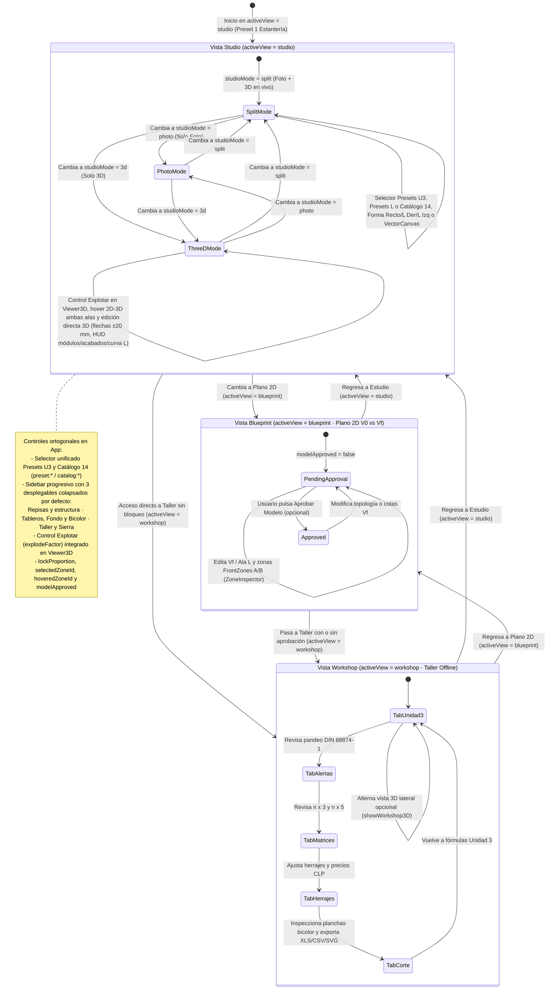
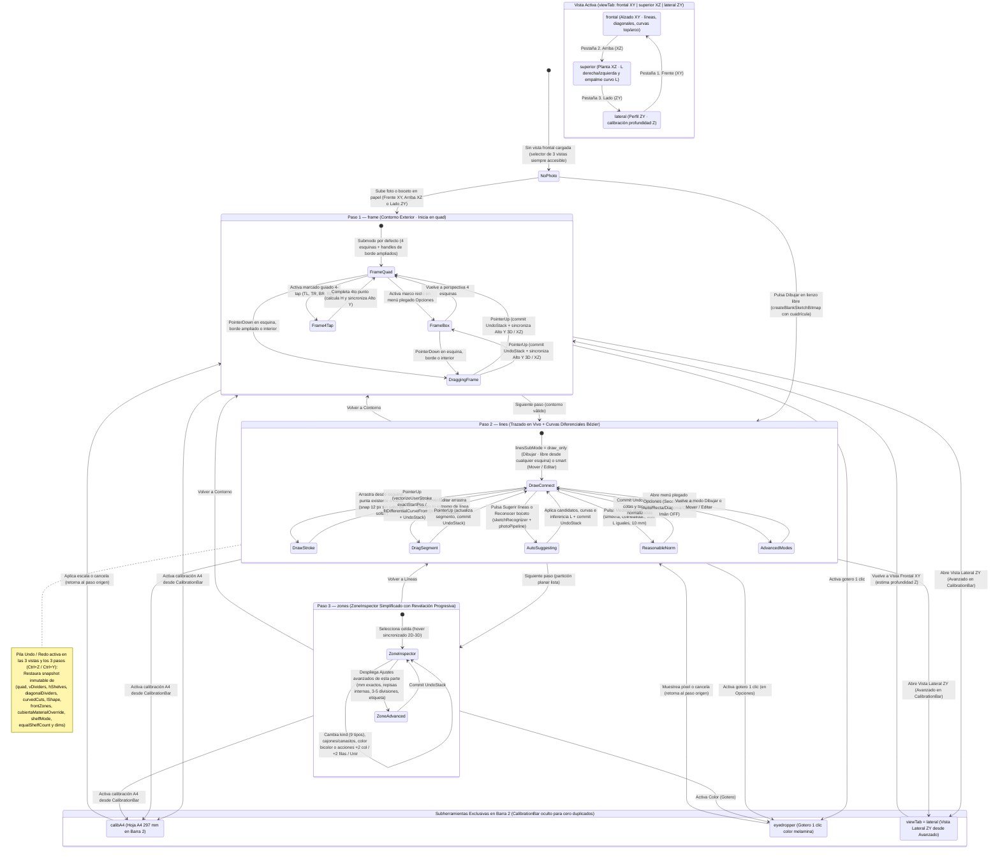

# 04 — Diagramas de Máquinas de Estados (SmartFurniture v8.0)

> Especificación formal de estados para el orquestador global (`App.tsx`) y el editor interactivo de fotografía (`VectorCanvas` v8.0), reflejando la UX simplificada con revelación progresiva, cero secuestros de herramientas y cero duplicación de controles.

## Máquina de Estados A — Navegación, Modos de Estudio y Aprobación de `App.tsx`

## Máquina de Estados B — `VectorCanvas` v8.0 (3 Vistas Ortogonales, Dibujo Libre con Curvas Diferenciales y Undo/Redo)

## Invariantes de Interacción v8.0

1. **Lienzo Limpio sin Barras Innecesarias + Barra Superior de 3 Vistas:** Sin vista cargada en `frontal`, solo se muestran las pestañas `1. Frente (XY)`, `2. Arriba (XZ)`, `3. Lado (ZY)`, `"Medidas razonables"` y el acceso directo `"Dibujar en lienzo libre"`.
2. **Sincronización Automática 3-Vistas y Cálculo Diferencial:** Ajustar `quad` (XY), `topQuad` (XZ) o `sideQuad` (ZY) ejecuta `synthesize3DFromTriViews`, sincronizando proporción `Alto Y`, profundidad `Z`, topología en L y curvas Bézier (`s = ∫ds`, `κ = 1/R`) en tiempo real.
3. **Revelación Progresiva y Cero Duplicación:** En Paso 2 (`lines`), la barra visible inicia en `Dibujar` (`draw_only`) junto al selector explícito `Línea recta | Curva` y el botón `Milimetrado` (cuadrícula proyectiva + ajuste a múltiplos de `10 mm`/`50 mm`), manteniendo `Mover / Editar` separado para que ninguna línea previa secuestre al trazar en una esquina (tanto esquinas azules del marco exterior como vértices internos); en `Arriba XZ` y `Lado ZY` la barra separa `Dibujar` de `Marco` e incluye `Línea recta | Curva`.
4. **Historial Unificado (`Undo/Redo`):** Toda mutación confirmada guarda un snapshot inmutable completo que incluye `dims`, `cubiertaMaterialOverride`, `curvedCuts` y `lShape`.
