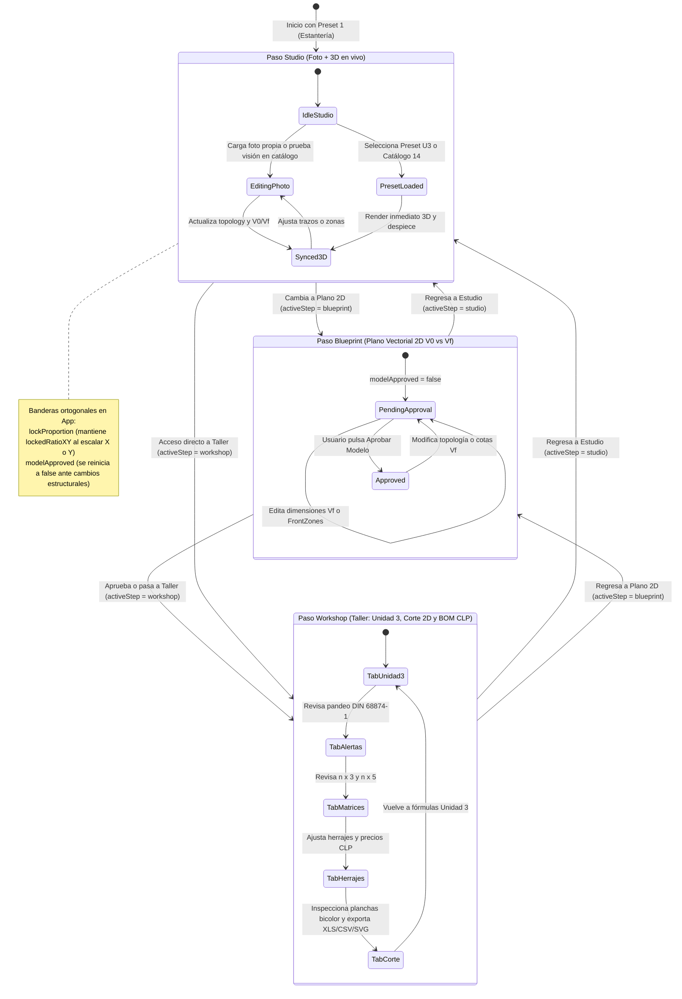
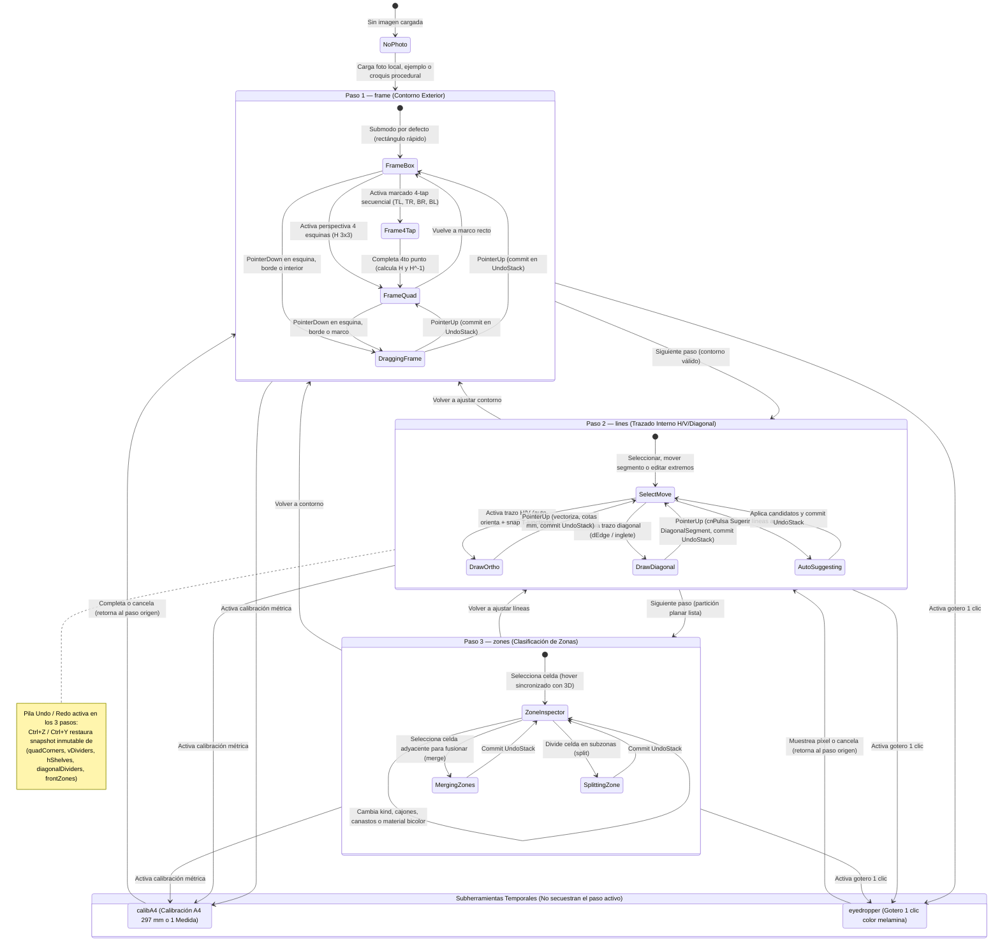

# 04 — Diagramas de Máquinas de Estados (SmartFurniture v8.0)

> Especificación formal de estados para el orquestador global (`App.tsx`) y el editor interactivo de fotografía (`VectorCanvas` v8.0), garantizando transiciones predecibles y cero secuestros de herramientas.

## Máquina de Estados A — Navegación y Aprobación de `App.tsx`

## Máquina de Estados B — `VectorCanvas` v8.0 (3 Pasos Exclusivos + Subherramientas + Undo/Redo)

## Invariantes de Interacción v8.0

1. **Exclusividad de Paso:** En todo instante el usuario opera exactamente en uno de los 3 pasos (`frame`, `lines` o `zones`), evitando interacciones accidentales (por ejemplo, arrastrar una esquina del marco mientras intenta seleccionar una puerta en `zones`).
2. **Retorno Limpio de Subherramientas:** Activar `calibA4` o `eyedropper` memoriza el paso previo y, al finalizar el clic/trazo o pulsar `Escape`, devuelve el control automáticamente al paso anterior sin dejar la herramienta bloqueada.
3. **Historial Unificado (`Undo/Redo`):** Toda mutación confirmada (al soltar el puntero en drag, completar un trazo, ejecutar auto-sugerencia, fusionar/dividir zonas o cambiar tipo/color) inserta exactamente un estado en la pila `Undo` y limpia `Redo`.
