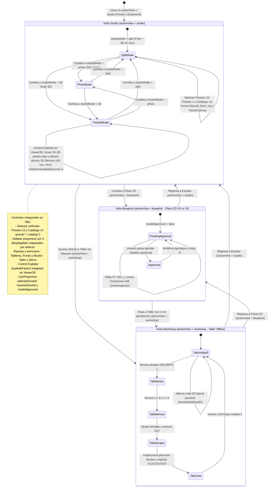
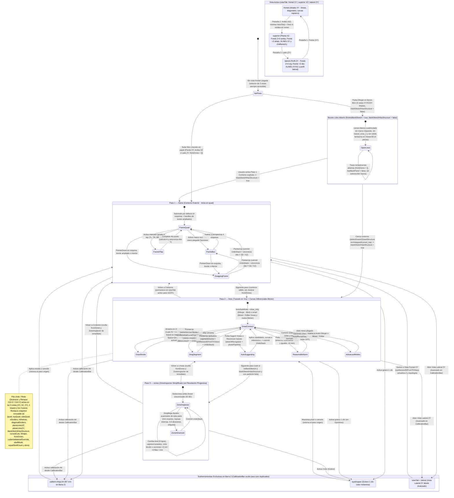

# 04 — Diagramas de Máquinas de Estados (SmartFurniture v8.0)

> Especificación formal de estados para el orquestador global (`App.tsx`) y el editor interactivo de fotografía (`VectorCanvas` v8.0), reflejando la UX simplificada con revelación progresiva, cero secuestros de herramientas y cero duplicación de controles.

## Máquina de Estados A — Navegación, Modos de Estudio y Aprobación de `App.tsx`

## Máquina de Estados B — `VectorCanvas` v8.0 (3 Vistas Ortogonales, Dibujo Libre con Curvas Diferenciales y Undo/Redo)

## Invariantes de Interacción v8.0

1. **Lienzo Limpio sin Barras Innecesarias, 3 Vistas Coherentes y Estado Vacío Real:** Al iniciar `"Dibujar en lienzo libre (3 vistas)"`, se crean los 3 lienzos ortogonales (`XY`, `XZ`, `ZY`) alineados sin marco sólido impuesto, sin sombreado fuera del marco, sin `traced_zone_1`, sin `hasBackPanel: true` y con `Viewer3D` en estado de espera (`0 piezas`, sin mueble fantasma) hasta detectar un contorno cerrado (`detectDrawnClosedStructure`) o confirmar `1. Contorno`.
2. **Separación Estricta de Partes (`3. Partes`) vs Dibujo (`1. Contorno` / `2. Líneas`):** `frontZones` y `ZoneInspector` solo se muestran cuando `traceStep === 'zones' && viewTab === 'frontal' && hasPhoto && (!isBlankSketch || blankSketchHasStructure)`. Al cambiar a `Arriba (XZ)` o `Lado (ZY)`, cualquier estado `'zones'` se normaliza automáticamente a `'lines'`, y `BARRA 1` conserva la pestaña activa al alternar `1. Contorno` / `2. Líneas`.
3. **Coherencia Ortogonal (`XLINE`), Cuadrícula `0-based` y Curvas Diferenciales en 3 Planos:** `Arriba (XZ)` ubica Fondo (`Z = 0`) arriba y Frente (`Z = +D`) abajo compartiendo `X` con `XY`; `Lado (ZY)` ubica Fondo (`Z = 0`) a la izquierda y Frente (`Z = +D`) a la derecha compartiendo `Y` con `XY`. La cuadrícula milimetrada es `0-based` exterior `[0..xf]×[0..yf]` sin desfase de `18 mm`, las proyecciones `XLINE` reflejan divisores/repisas/profundidad entre planos, `Lupa 4×` y `Space + Arrastrar` operan en los 3 planos, `planeLinesXZ`/`planeLinesZY` y curvas `zy` recortan piezas 3D reales en `differentialCurve.ts`/`Viewer3D`, y los nodos Bézier `P0..P3` son seleccionables y editables en `2D` y `LineSelectionBar`.
4. **Historial Unificado (`Undo/Redo` en XY/XZ/ZY + 4 Toques):** Toda mutación confirmada (contorno, líneas en `Frente`/`Arriba`/`Lado`, curvas, zonas, `blankSketchHasStructure` y toques de esquina) guarda estado reversible con `Deshacer` (`Ctrl+Z`) y `Rehacer` (`Ctrl+Y`).
