# 05 — Diagrama de Actividad del Flujo UX Dual (SmartFurniture v8.0)

> Describe las dos entradas complementarias de **SmartFurniture v8.0** —la ruta académica/QA instantánea mediante selector unificado (Rama A) y la ruta simplificada de digitalización desde fotografía propia (Rama B)— y su convergencia hacia la parametrización progresiva, la validación 2D/3D y el acceso directo a Taller 100 % offline.

```mermaid
flowchart TD
    START(["Inicio en navegador o PWA Offline"]) --> CHOICE{"Origen del mueble"}

    subgraph RAMA_A["Rama A — Selector Unificado: Presets Unidad 3, Presets en L y Catálogo QA (14 Fotos)"]
        A1["Elegir en selector unificado: Preset U3, Preset Mueble en L (Escritorio/Cocina/Clóset L) o Mueble del Catálogo 14"]
        A2["Cargar topología verificada (detectionSource = preset)"]
        A3{"Desea probar motor de visión real sobre la foto del catálogo?"}
        A4["Abrir foto en VectorCanvas y ejecutar Sugerir líneas o trazado real"]
        A1 --> A2 --> A3
        A3 -- "Sí (Benchmark / Demo)" --> A4
    end

    subgraph RAMA_B["Rama B — 3 Vistas Ortogonales (Foto, Dibujo en Papel o Lienzo Libre con Curvas)"]
        B1["Elegir pestaña Frente (XY), Arriba (XZ) o Lado (ZY): subir foto, subir dibujo en papel o pulsar Dibujar en lienzo libre"]
        B2["Reconocimiento automático (sketchRecognizer + photoPipeline) o ajuste manual quad 4 esquinas con homografía H 3x3 (Hartley)"]
        B3["Fusión 3-Vistas (synthesize3DFromTriViews): combina ancho X, alto Y, profundidad Z y detecta planta en L desde Arriba (XZ)"]
        B4["Calibrar escala real: confirmar 1 medida conocida o Hoja A4 297 mm sin controles duplicados"]
        B5["Dibujo libre en vivo: trazos rectos/diagonales con snap o Modo Curva Bézier (cálculo diferencial s = ∫ds, curvatura κ y empalmes L)"]
        B6["Pulsar Medidas razonables: alinea tramos colineales, simetría 1/2..3/4, iguala lados de alas en L y redondea a múltiplos de 10 mm"]
        B7{"Confianza de detección >= 0.50 o trazado manual completo?"}
        B8["Ajuste fino opcional arrastrando líneas/curvas con Undo/Redo completo (incluye dims, bicolor, curvas y L)"]
        B9["Aviso explícito de baja confianza: completar líneas en modo Editar / Trazar"]
        B10["Paso 3 zones: ZoneInspector simplificado (9 tipos, cajones/canastos, color bicolor, +2 col / +2 filas / Unir; ajustes avanzados plegados)"]
        B1 --> B2 --> B3 --> B4 --> B5 --> B6 --> B7
        B7 -- "Sí" --> B8 --> B10
        B7 -- "No" --> B9 --> B10
    end

    CHOICE -- "Rama A: Demo rápida / Unidad 3 / QA" --> A1
    CHOICE -- "Rama B: Foto / Dibujo 3-Vistas" --> B1

    A3 -- "No (Ir directo a parametrización)" --> CONV
    A4 --> CONV
    B10 --> CONV

    subgraph CONVERGENCIA["Fase Común — Parametrización Progresiva (Recto / L + Curvas Diferenciales), Validación y Taller"]
        CONV["Ajustar medidas Vf (mm/cm), planta Recto / L Der / L Izq (L2, Z2, Alto B, esquina abierta, esquina interior curva R) y material"]
        REV["Revisar en vivo: Visor 3D interactivo (alas L + ExtrudeGeometry curva, Explotar) y Plano Vectorial 2D (Planta XZ + Alzados A/B + rutas Bézier)"]
        ALERT{"Alerta estructural DIN 68874-1, pandeo > 850 mm o radio curvo R < 28 mm?"}
        FIX["Agregar divisor vertical o ampliar radio curvo en vivo hasta 0 alertas"]
        BLUEPRINT_OPT["Opcional: revisar Plano 2D V0 vs Vf y marcar Aprobar Modelo (modelApproved = true)"]
        WORKSHOP["Acceso directo a Taller (sin compuerta bloqueante): Unidad 3 (incl. Curvas Diferenciales), Alertas DIN, Matrices, Corte 2D Bicolor y Presupuesto CLP"]
        EXPORT["Exportar 100 % offline: Excel .xls (3 hojas), CSV Chile (; + BOM UTF-8) y Planos SVG"]

        CONV --> REV --> ALERT
        ALERT -- "Sí" --> FIX --> REV
        ALERT -- "No (Directo a Taller)" --> WORKSHOP
        ALERT -- "No (Revisar Plano 2D)" --> BLUEPRINT_OPT --> WORKSHOP
        WORKSHOP --> EXPORT
    end

    EXPORT --> ENDNODE(["Fin: Proyecto listo para corte en taller y entrega INACAP"])
```

## Claves de Usabilidad del Flujo Dual

- **Transparencia en Rama A:** Los 3 presets oficiales Unidad 3 y los 14 muebles del catálogo QA se eligen desde un selector unificado (`preset:*` / `catalog:*`) con `detectionSource: 'preset'`, permitiendo probar el motor de visión real (`photoPipeline`) sobre cualquier foto del catálogo en 1 clic.
- **Ruta Fluida 3-Vistas y Dibujo Libre en Rama B:** El editor permite alternar entre `Frente (XY)`, `Arriba (XZ)` y `Lado (ZY)` aceptando fotografías, dibujos hechos a mano sobre papel (`sketchRecognizer`) o trazado directo en tiempo real sobre lienzo libre con curvas Bézier diferenciales y botón `"Medidas razonables"` para cuadrar cotas correspondientes; el historial `Undo/Redo` cubre también `dims`, `cubiertaMaterialOverride`, `curvedCuts` y `lShape`.
- **Acceso Directo a Taller + Revelación Progresiva:** El usuario puede pasar a Taller en cualquier momento sin bloqueo obligatorio por aprobación previa, con los parámetros secundarios del sidebar plegados en 3 secciones colapsables y el control `Explotar` integrado directamente en `Viewer3D`.
- **Aislamiento de Costos y Herrajes:** Tanto en Rama A como en Rama B, patas, ruedas, tiradores, bisagras, correderas y canastos se gestionan en `hardwareSummary` y en el estimador CLP sin alterar nunca las cotas de melamina ni contaminar las planchas de corte.
