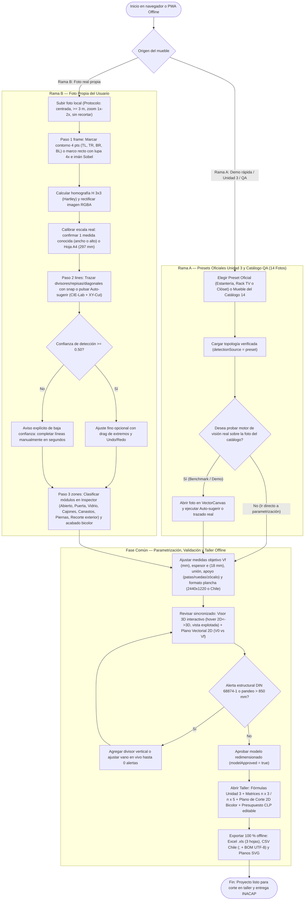

# 05 — Diagrama de Actividad del Flujo UX Dual (SmartFurniture v8.0)

> Describe las dos entradas complementarias de **SmartFurniture v8.0** —la ruta académica/QA instantánea (Rama A) y la ruta de digitalización desde fotografía propia (Rama B)— y su convergencia hacia el escalamiento paramétrico, la validación 2D/3D y la exportación 100 % offline.

## Claves de Usabilidad del Flujo Dual

- **Transparencia en Rama A:** Los 14 muebles del catálogo de prueba cargan con `detectionSource: 'preset'` para demostrar el abanico completo de tipologías (puertas, vidrio, cajones, canastos, ruedas, escritorios, bicolor, recortes escalonados) y permiten lanzar en cualquier momento una corrida real del motor de visión sobre la foto subyacente.
- **Ruta Garantizada en Rama B:** Aunque una foto presente bajo contraste (ej. mueble blanco frente a muro blanco), la detección automática actúa como asistente con índice de confianza explícito (`< 0.50`) y el trazado guiado en 3 pasos (`frame` -> `lines` -> `zones`) garantiza siempre llegar al modelo 3D y al despiece milimétrico sin bloqueos.
- **Aislamiento de Costos y Herrajes:** Tanto en Rama A como en Rama B, patas, ruedas, tiradores, bisagras, correderas y canastos se gestionan en `hardwareSummary` y en el estimador CLP sin alterar nunca las cotas de melamina ni contaminar las planchas de corte.
